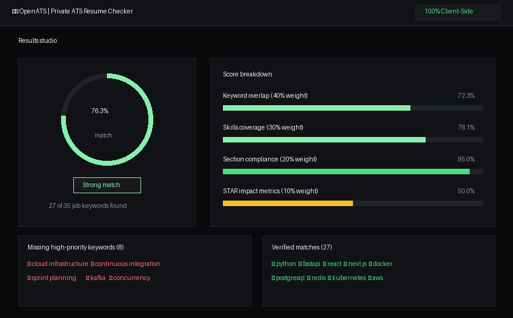
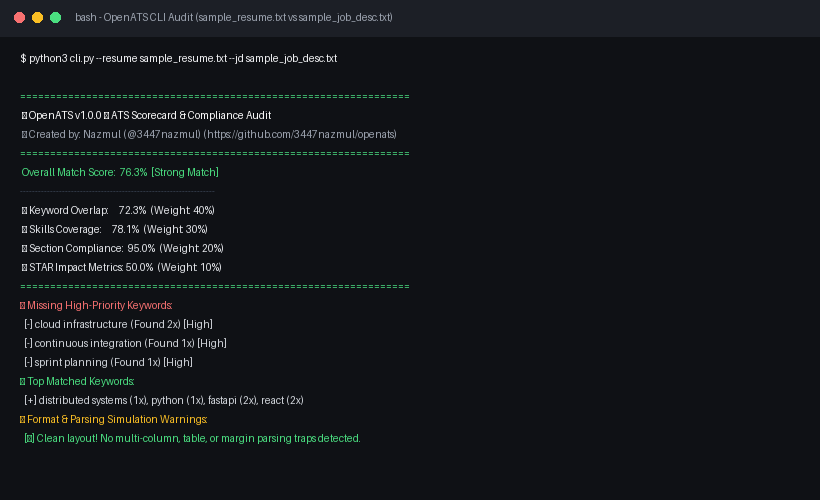

<div align="center">

# ⚡ OpenATS
### High-Performance, Privacy-First ATS Resume Matcher & Optimizer
**Free and Open-Source Local Alternative to Paid SaaS Scanners**

[](LICENSE)
[](pyproject.toml)
[](pyproject.toml)
[](https://github.com/3447nazmul/openats/actions/workflows/test.yml)
[](https://github.com/3447nazmul/openats/releases/tag/v1.0.0)
[](https://3447nazmul.github.io/openats)
[-black.svg)](https://github.com/3447nazmul)

<p align="center">
  <a href="https://3447nazmul.github.io/openats"><b>🌐 Try Live Web Demo</b></a> •
  <a href="#-quick-start"><b>⚡ Quick Start</b></a> •
  <a href="#-feature-comparison"><b>💸 Feature Comparison</b></a> •
  <a href="#-cli-usage"><b>💻 CLI Usage</b></a> •
  <a href="#-limitations--scope"><b>⚠️ Limitations</b></a> •
  <a href="#-author--maintainer"><b>👤 Author</b></a>
</p>

</div>

---

## 💡 What is OpenATS?

**OpenATS** provides a free, local keyword and structure audit inspired by tools like Jobscan — not affiliated with or identical to Jobscan.

Automated Applicant Tracking Systems (ATS) and corporate recruitment tools are widely used by employers to screen and index resumes before human review. Commercial tools exploit this by charging job seekers up to $49.95/month for basic keyword comparison.

**OpenATS gives you an algorithmic ATS audit for free**, with no account, no resume upload, and no scan limit. Both the browser web application and the Python engine share identical scoring rules and produce matching scores down to the decimal point (verified via [`parity.md`](parity.md)).

---

## 📸 Screenshots

<div align="center">

### Browser Dashboard & Results Studio


### Terminal CLI Scorecard & Format Audit


</div>

---

## 🔒 Privacy & Network Transparency

Your resume and job description text never leaves your device:
- **Zero Resume Upload**: All parsing, keyword extraction, scoring, and STAR optimizations execute 100% locally on your machine or inside your browser tab.
- **Client Web Assets**: The web application is self-contained with no runtime CSS frameworks. Pinned document parsing libraries (`pdf.js` v3.11.174 and `mammoth` v1.6.0) load from CDNs with cryptographic Subresource Integrity (SRI) hashes and local vendor fallbacks.
- **Update Checker**: The optional CLI and web update check contacts the public GitHub API (`api.github.com`) to check for newer releases, and results are cached in-process for 1 hour.

---

## 💸 Feature Comparison

*(Comparison verified as of November 2026 based on publicly available plan pricing and feature documentation)*

| Feature | Jobscan | Teal | Rezi | **OpenATS (Free)** |
| :--- | :---: | :---: | :---: | :---: |
| **Monthly Pricing** | ~$49.95 / mo (or quarterly) | ~$29.00 / mo | ~$29.00 / mo | **$0.00 (Forever Free)** |
| **Scan Limits** | Limited on Free tier | Limited on Free tier | Limited on Free tier | **Unlimited Scans** |
| **Resume Data Privacy** | Cloud server processing | Cloud server processing | Cloud server processing | **Local Processing (No Resume Upload)** |
| **Open Source** | ❌ Proprietary | ❌ Proprietary | ❌ Proprietary | **✅ 100% MIT Open Source** |
| **Live Web App (No Install)**| Behind account | Behind account | Behind account | **✅ Free on GitHub Pages** |
| **CLI / Developer Mode**| ❌ No | ❌ No | ❌ No | **✅ Full CLI & JSON Support** |
| **STAR Bullet Enhancer**| Paid Add-on | Basic / AI quota | Basic / AI quota | **✅ Built-in Offline Heuristics** |
| **Python Dependencies** | N/A | N/A | N/A | **Zero Required (`pure stdlib`)** |

---

## 🚀 Key Features

* **⚡ Real-Time ATS Compatibility Scoring (0–100%)**: Weighted algorithmic scoring across Keyword Overlap (40%), Skill Taxonomy Coverage (30%), Section & Heading Compliance (20%), and STAR Quantifiable Impact (10%).
* **🎯 100% Cross-Platform Parity**: The web application and Python CLI produce identical scores down to the decimal point (verified via [`scripts/parity_check.js`](scripts/parity_check.js)).
* **🚨 Keyword Gap & Missing Skills Matrix**: Pinpoints high-frequency hard skills, tools, and technical competencies present in the job description that are missing from your resume.
* **📚 1,344 Categorized Skill Taxonomy**: Single source of truth with recognition across 8 domains and 143 bidirectional aliases (`AWS` ↔ `Amazon Web Services`, `k8s` ↔ `Kubernetes`).
* **🎯 STAR Framework Bullet Point Enhancer**: Audits your resume's experience bullets for strong past-tense action verbs, grammatically restructures weak openers, and inserts transparent placeholders (`[ADD YOUR REAL RESULT: e.g. reduced time by __%]`). Never scores above 70 without a real metric.
* **📂 Universal Input & Drag-and-Drop**: Paste text directly or drag & drop `.pdf`, `.docx`, `.txt`, and `.md` files with client-side text extraction.
* **📄 Format & Layout Simulation Audit**: Proactively warns if your resume layout uses multiple columns, table structures, or margin text that commonly break real ATS parsers.
* **💾 Local Scan History & Multi-Job Comparison**: Compare your resume against up to 3 saved jobs in a side-by-side scorecard matrix. Export and import history as JSON.

---

## ⚠️ Limitations & Scope

Please keep the following constraints in mind when using OpenATS:
- **Readiness Estimates, Not Vendor Guarantees**: Scores are heuristic readiness estimates to aid job preparation. They do not simulate or replicate the proprietary, black-box algorithms of individual enterprise ATS systems (Workday, Taleo, Greenhouse, Lever).
- **English-Focused Taxonomy**: The 1,344 skills, 143 aliases, and action verbs are optimized for English-language resumes.
- **Tech-Heavy Vocabulary**: Current taxonomy coverage is primarily focused on software engineering, cloud, data science, DevOps, product management, and modern digital roles.
- **No Native OCR**: Scanned, photocopied, or image-flattened PDFs cannot be parsed without prior OCR.
- **Contact Information Privacy**: When using the CLI `--json` flag or server API, raw email addresses and phone numbers are excluded from the output by default to protect personal data; pass `--include-contact` to include them.

---

## ⚡ Quick Start

### Option 1: Use Live in Your Browser (No Setup Required)
Visit the live web app hosted directly on GitHub Pages:  
👉 **[https://3447nazmul.github.io/openats](https://3447nazmul.github.io/openats)**

### Option 2: Run Locally (Desktop Web App)
Clone the repository and launch the local server with one command:
```bash
git clone https://github.com/3447nazmul/openats.git
cd openats
python3 app.py
```
OpenATS will launch and automatically open **`http://127.0.0.1:8080`** in your default web browser.

---

## 💻 CLI Usage

OpenATS comes with a terminal CLI for developers and automated workflows:

```bash
# Run scan on plain text or Markdown files (.txt, .md)
python3 cli.py --resume sample_data/sample_resume.txt --jd sample_data/sample_job_desc.txt

# Run scan directly on PDF or Word (.docx) resumes
# (DOCX works zero-install via stdlib; for PDF install optional adapter: pip install "openats[pdf]")
python3 cli.py --resume tests/fixtures/resume.pdf --jd sample_data/sample_job_desc.txt
python3 cli.py --resume tests/fixtures/resume.docx --jd sample_data/sample_job_desc.txt

# Run with format and layout simulation check
python3 cli.py --resume tests/fixtures/multi_column.pdf --jd sample_data/sample_job_desc.txt

# Optimize a single resume bullet point using the STAR framework
python3 cli.py --bullet "Responsible for database maintenance and query optimization"

# Output formatted JSON for integration into custom scripts
python3 cli.py --resume my_resume.pdf --jd job.txt --json > results.json

# Check for official GitHub updates (cached in-process for 1 hour)
python3 cli.py --check-update
```

---

## 🔄 Building Web Data & Cross-Platform Parity

The Python package `openats/taxonomy.py` serves as the single source of truth for all skills, aliases, and action verbs. Whenever the taxonomy is updated, regenerate the web bundle with:

```bash
# Regenerate openats/templates/skills.json and update index.html
python3 scripts/build_web_data.py

# Verify exact score parity between Python and Browser JS engines
node scripts/parity_check.js
```
See [`parity.md`](parity.md) for full benchmarks and mathematical proofs.

---

## 🧪 Quality Control & Automated Tests

OpenATS includes an exhaustive unit and integration test suite:

```bash
python3 run_qc_suite.py
```
*Certified 100% passing across Python 3.8, 3.9, 3.10, 3.11, and 3.12 via GitHub Actions CI.*

---

## 👤 Author & Maintainer

Created and maintained with ❤️ by **Nazmul**:
* **GitHub Profile:** [@3447nazmul](https://github.com/3447nazmul)
* **Repository:** [https://github.com/3447nazmul/openats](https://github.com/3447nazmul/openats)
* **Live App:** [https://3447nazmul.github.io/openats](https://3447nazmul.github.io/openats)

---

## 📄 License

Distributed under the **MIT License**. See [`LICENSE`](LICENSE) for full details.
